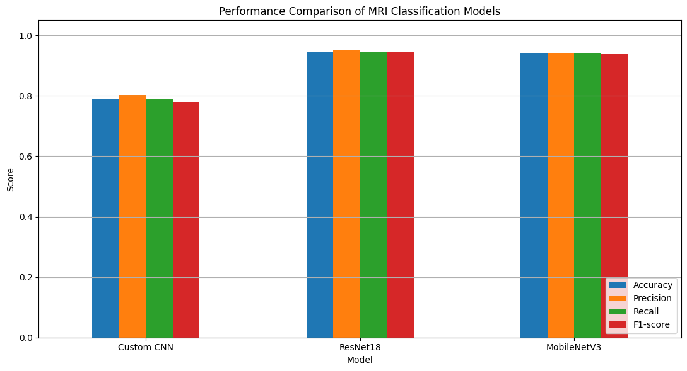
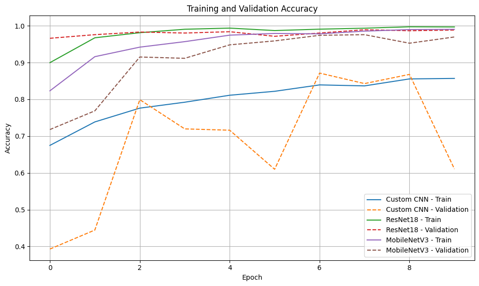
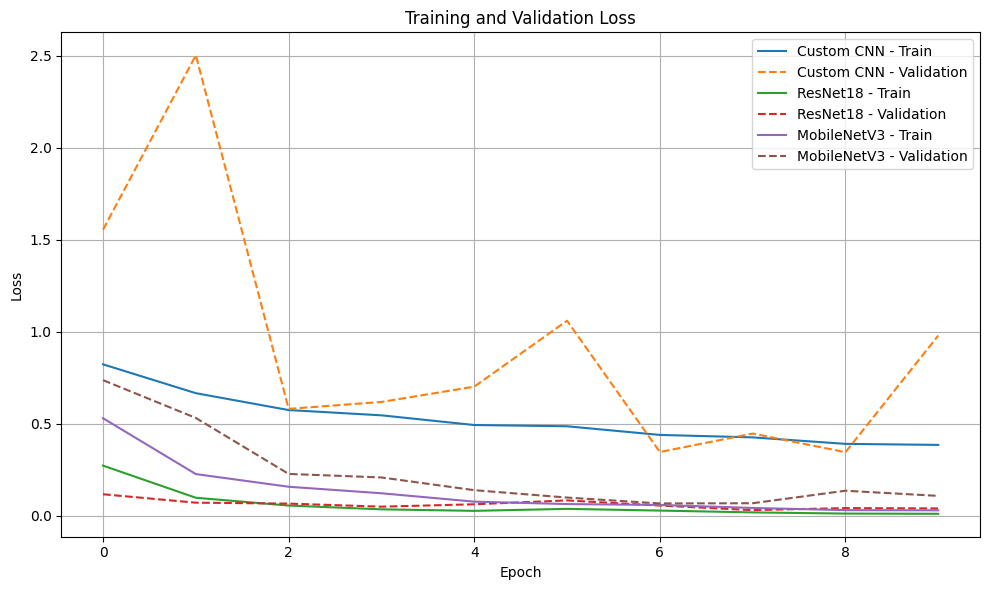
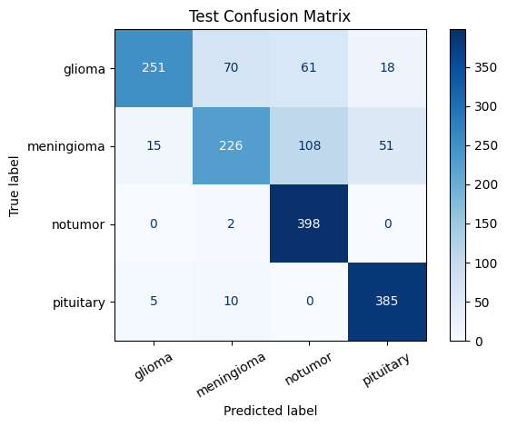
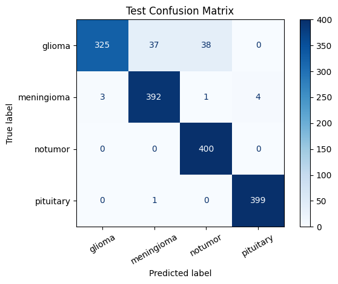
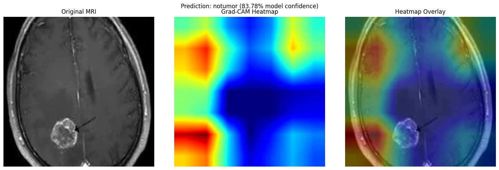

# Brain Tumor Detection from MRI Images

[](https://pytorch.org/)
[](https://streamlit.io/)
[](https://colab.research.google.com/)
[](LICENSE)
[](#)

An end-to-end deep learning and Explainable AI (XAI) system for detecting and classifying brain tumors from magnetic resonance imaging (MRI) scans. Developed with **PyTorch**, this project evaluates three distinct convolutional neural network architectures (**Custom CNN**, **ResNet18**, and **MobileNetV3**), provides visual interpretability using **Grad-CAM** saliency maps, and delivers an interactive **Streamlit** web application for real-time inference and model performance analytics.

---

## 📌 Table of Contents
- [Project Overview & Objectives](#-project-overview--objectives)
- [Dataset Details](#-dataset-details)
- [Technologies & Model Architectures](#-technologies--model-architectures)
- [Repository Structure](#-repository-structure)
- [Model Evaluation & Comparative Results](#-model-evaluation--comparative-results)
- [Visualizations & Screenshots](#-visualizations--screenshots)
- [Google Colab Training Workflow](#-google-colab-training-workflow)
- [Streamlit Web Application Setup](#-streamlit-web-application-setup)
- [Explainability with Grad-CAM](#-explainability-with-grad-cam)
- [Limitations & Medical Disclaimer](#-limitations--medical-disclaimer)
- [License & Acknowledgments](#-license--acknowledgments)

---

## 🧠 Project Overview & Objectives

Early and accurate diagnosis of intracranial neoplasms is critical for patient survival, treatment planning, and surgical intervention. Traditional manual analysis of axial brain MRI scans by radiologists is time-intensive and subject to inter-observer variability. 

The primary objectives of this project are:
1. **Automated Multi-Class Classification:** Classify axial brain MRI scans into four distinct diagnostic categories: *Glioma*, *Meningioma*, *Pituitary Tumor*, or *No Tumor*.
2. **Architectural Benchmarking:** Conduct a rigorous empirical comparison between a custom baseline convolutional neural network (Custom CNN) and transfer-learning backbones (ResNet18 and MobileNetV3).
3. **Interpretability via Grad-CAM:** Utilize Gradient-weighted Class Activation Mapping (Grad-CAM) to generate visual saliency heatmaps highlighting the exact pathological regions influencing model predictions.
4. **Interactive Clinical Web Application:** Deploy a production-ready Streamlit interface that enables single and batch MRI analysis, confidence scores, multi-model selection, and interactive explainability maps.

---

## 📊 Dataset Details

- **Dataset Name:** Brain Tumor MRI Dataset
- **Source:** [Kaggle (`masoudnickparvar/brain-tumor-mri-dataset`)](https://www.kaggle.com/datasets/masoudnickparvar/brain-tumor-mri-dataset)
- **Modality:** T1-weighted contrast-enhanced brain magnetic resonance imaging (MRI)
- **Dataset Partitioning:**
  - **Training Set:** 4,480 images (after an 80/20 train/validation split of the 5,712 training partition)
  - **Validation Set:** 1,120 images
  - **Test Set:** 1,600 images (balanced across all 4 categories: 400 per class)
- **Target Classes (4 categories):**
  1. `glioma`: Glial cell neoplasms originating in the brain parenchyma or spine.
  2. `meningioma`: Typically benign intracranial tumors arising from the meningeal coverings of the brain and spinal cord.
  3. `notumor`: Healthy baseline scans exhibiting no visible neoplasm or lesion.
  4. `pituitary`: Neoplasms developing within the pituitary gland sella turcica.

---

## 🔬 Technologies & Model Architectures

### Technology Stack
- **Deep Learning Framework:** PyTorch, Torchvision
- **Web Application:** Streamlit
- **Explainable AI (XAI):** Grad-CAM (PyTorch forward/backward hook implementation)
- **Scientific Computing & Metrics:** Scikit-learn, NumPy, Pandas, SciPy
- **Visualization:** Matplotlib, Seaborn, PIL (Pillow)
- **Training Environment:** Google Colab with NVIDIA Tesla T4 GPU acceleration

### Model Architecture Specifications

1. **Custom CNN (Baseline Architecture):**
   - **Structure:** 4 sequential convolutional blocks (32, 64, 128, 256 filters with 3×3 kernels, stride 1, padding 1).
   - **Normalization & Pooling:** Each block contains `BatchNorm2d`, `ReLU` activation, and `MaxPool2d(2, 2)`.
   - **Classification Head:** Global `AdaptiveAvgPool2d(1, 1)`, followed by `Flatten`, `Linear(256, 128)`, `ReLU`, `Dropout(0.5)`, and `Linear(128, 4)`.
   - **Parameters:** ~423,000 parameters (~1.63 MB checkpoint size).

2. **ResNet18 (Residual Deep Learning Backbone):**
   - **Structure:** 18-layer deep residual network utilizing skip connections to eliminate vanishing gradient problems.
   - **Initialization:** Transfer learning with ImageNet pretrained weights (`ResNet18_Weights.DEFAULT`).
   - **Head Adaptation:** Replaced standard 1000-class fully-connected layer with `nn.Linear(512, 4)`.
   - **Parameters:** ~11.2 million parameters (~42.72 MB checkpoint size).

3. **MobileNetV3 (Lightweight Mobile/Edge Backbone):**
   - **Structure:** Hard-Swish activation, inverted residual blocks, and lightweight Squeeze-and-Excitation (SE) modules for efficient parameter utilization.
   - **Initialization:** Pretrained ImageNet weights (`MobileNet_V3_Weights.DEFAULT`).
   - **Head Adaptation:** Final linear classification layer configured for 4-class output.
   - **Parameters:** ~4.2 million parameters (~16.24 MB checkpoint size).

---

## 📁 Repository Structure

```text
brain-tumor-detection/
├── .gitignore                          # Git exclusion rules (caches, venvs, large .pth weights)
├── README.md                           # Comprehensive documentation and execution guide
├── app.py                              # Interactive Streamlit Web Application
├── requirements.txt                    # Python environment dependencies
├── generate_dummy_weights.py           # Testing utility to instantiate initialized checkpoints
├── gradcam.py                          # Standalone PyTorch hook-based Grad-CAM module
├── model_architectures.py              # Architecture definitions, preprocessing & weight loader
├── notebooks/
│   └── brain_tumor_detection.ipynb     # Complete training, evaluation & Grad-CAM Colab notebook
├── models/
│   └── README.md                       # Model weight specifications, links & hosting guide
├── results/
│   ├── class_names.json                # Verified 4-class label mappings
│   ├── model_comparison.csv            # Empirical test metrics across all three architectures
│   └── confusion_matrices/
│       ├── custom_cnn_confusion_matrix.png
│       ├── resnet18_confusion_matrix.png
│       └── mobilenetv3_confusion_matrix.png
└── screenshots/
    ├── class_distribution.png          # Dataset class balance breakdown
    ├── sample_mri_scans.png            # Visual samples of dataset MRI scans
    ├── training_validation_accuracy.png# Training vs validation accuracy curves (10 epochs)
    ├── training_validation_loss.png    # Training vs validation loss curves (10 epochs)
    ├── model_performance_comparison.png# Bar chart comparing accuracy, precision, recall, F1
    └── gradcam_explanation.png         # Grad-CAM heatmap overlay demonstration
```

---

## 📈 Model Evaluation & Comparative Results

Each model was trained for 10 epochs using cross-entropy loss, Adam optimization, and `ReduceLROnPlateau` dynamic learning rate scheduling. Models were evaluated on the independent, balanced test partition of **1,600 MRI images** (400 scans per class).

### Performance Metrics Table

| Model Architecture | Test Accuracy | Macro Precision | Macro Recall | Macro F1-Score | Best Val Acc (Epoch) | Training Time | Checkpoint Size |
| :--- | :---: | :---: | :---: | :---: | :---: | :---: | :---: |
| **ResNet18** | **94.75%** | **0.9509** | **0.9475** | **0.9462** | **98.93%** (Epoch 8) | 4.94 min | 42.72 MB |
| **MobileNetV3** | **93.94%** | **0.9428** | **0.9394** | **0.9379** | **97.59%** (Epoch 8) | 4.39 min | 16.24 MB |
| **Custom CNN** | **78.75%** | **0.8025** | **0.7875** | **0.7778** | **87.14%** (Epoch 7) | 4.87 min | 1.63 MB |

### Per-Class Test Performance (ResNet18 - Top Model)

```text
              Precision    Recall  F1-Score   Support
      glioma       0.99      0.81      0.89       400
  meningioma       0.91      0.98      0.94       400
     notumor       0.91      1.00      0.95       400
   pituitary       0.99      1.00      0.99       400

    accuracy                           0.95      1600
   macro avg       0.95      0.95      0.95      1600
weighted avg       0.95      0.95      0.95      1600
```

### Key Observations
1. **Superiority of Residual Learning:** ResNet18 achieved the highest overall test accuracy (94.75%) and macro F1-score (0.9462). The deep residual skip connections preserved fine spatial textural features across contrast-enhanced scans.
2. **MobileNetV3 Efficiency:** MobileNetV3 performed comparably (93.94% accuracy) while having less than 40% of ResNet18's parameter footprint, making it ideal for edge inference and resource-constrained hospital deployment.
3. **Tumor Separation Challenges:** Glioma scans exhibited the greatest challenge across all architectures (recall: 0.81 for ResNet18), primarily due to diffuse histological boundaries and radiological overlap with high-grade meningiomas. Pituitary neoplasms demonstrated near-perfect recall (1.00) due to localized anatomical positioning within the sella turcica.

---

## 🖼️ Visualizations & Screenshots

### 1. Model Performance Comparison


### 2. Training & Validation Dynamics
| Accuracy Progression | Loss Reduction |
| :---: | :---: |
|  |  |

### 3. Test Confusion Matrices
| Custom CNN (78.75%) | ResNet18 (94.75%) | MobileNetV3 (93.94%) |
| :---: | :---: | :---: |
|  |  |  |

### 4. Explainable AI (Grad-CAM Saliency Maps)


---

## 🚀 Google Colab Training Workflow

To reproduce the complete training, evaluation, and export workflow from scratch in Google Colab:

1. Open [`notebooks/brain_tumor_detection.ipynb`](notebooks/brain_tumor_detection.ipynb) in Google Colab.
2. Enable a GPU accelerator: **Runtime > Change runtime type > Hardware accelerator > T4 GPU**.
3. Execute the notebook sequentially:
   - **Environment Setup:** Installs `kagglehub`, `torchvision`, and scientific dependencies.
   - **Automated Dataset Download:** Downloads `masoudnickparvar/brain-tumor-mri-dataset` directly from Kaggle.
   - **Dataset Loading & Splitting:** Applies random horizontal flips, rotations (±10°), resizing to 224×224, and ImageNet normalization.
   - **Model Training:** Trains Custom CNN, ResNet18, and MobileNetV3 for 10 epochs each with learning rate annealing.
   - **Evaluation:** Evaluates all three models on the 1,600-image test set, generating classification reports, confusion matrices, and ROC curves.
   - **Exporting Weights:** Packages `custom_cnn.pth`, `resnet18.pth`, `mobilenetv3.pth`, `class_names.json`, and `model_comparison.csv` into `brain_tumor_results.zip` for download.

---

## 💻 Streamlit Web Application Setup

The Streamlit web application allows users to upload local MRI scans, inspect model predictions with probability bars, explore Grad-CAM visual heatmaps, and compare model benchmark metrics.

### Local Installation

1. **Clone the repository:**
   ```bash
   git clone https://github.com/<your-username>/brain-tumor-detection.git
   cd brain-tumor-detection
   ```

2. **Create and activate a virtual environment:**
   ```bash
   # Windows (PowerShell)
   python -m venv venv
   .\venv\Scripts\Activate.ps1

   # Linux / macOS
   python3 -m venv venv
   source venv/bin/activate
   ```

3. **Install dependencies:**
   ```bash
   pip install --upgrade pip
   pip install -r requirements.txt
   ```

4. **Acquire model checkpoints:**
   - Place trained `.pth` files (`custom_cnn.pth`, `resnet18.pth`, `mobilenetv3.pth`) in the `models/` directory (or project root).
   - Alternatively, generate test dummy weights to explore the UI immediately:
     ```bash
     python generate_dummy_weights.py
     ```

5. **Launch the Streamlit application:**
   ```bash
   streamlit run app.py
   ```
   The application will open in your default browser at `http://localhost:8501`.

### Running Streamlit in Google Colab (LocalTunnel / Cloudflared)

If running directly in Google Colab:
```python
# 1. Install dependencies
!pip install -q streamlit pyngrok
!npm install -g localtunnel

# 2. Retrieve your Colab external IP (Tunnel Password)
import urllib
print("LocalTunnel Password:", urllib.request.urlopen('https://ipv4.icanhazip.com').read().decode('utf8').strip())

# 3. Launch Streamlit via LocalTunnel
!streamlit run app.py & npx localtunnel --port 8501
```

---

## 🔍 Explainability with Grad-CAM

Deep learning models in medical imaging are often perceived as "black boxes." To address clinical transparency, this repository implements **Grad-CAM (Gradient-weighted Class Activation Mapping)**:

1. **Activation Interception:** Forward hooks capture spatial feature maps at the final convolutional layer:
   - **ResNet18:** `model.layer4[-1].conv2`
   - **MobileNetV3:** `model.features[-1]`
   - **Custom CNN:** `model.features[12]` (Block 4 Conv2D)
2. **Gradient Interception:** Backward hooks compute gradients of the predicted class score with respect to each feature channel.
3. **GAP Weighting & Saliency:** Global Average Pooling (GAP) produces importance weights for each channel. A ReLU activation is applied to isolate features that positively influence the target diagnostic class.
4. **Bilinear Interpolation & Jet Colormap:** Heatmaps are upsampled to the original 224×224 resolution and blended over the grayscale MRI scan.

---

## ⚖️ Limitations & Medical Disclaimer

> [!WARNING]
> **ACADEMIC AND RESEARCH USE ONLY**
> 
> This software, including all models, weights, code, and visualizations, was developed exclusively for academic research as part of an undergraduate Data Science Honours project.
> 
> - **Not a Diagnostic Medical Device:** This application is **not** certified, accredited, or approved by the FDA, EMA, or any healthcare regulatory body.
> - **No Clinical Decision Support:** The predictions, confidence scores, and Grad-CAM saliency maps generated by this system must **not** be used to diagnose, triage, treat, or manage any medical condition or brain pathology.
> - **Histological Ground Truth:** Clinical diagnosis of brain neoplasms requires comprehensive histological biopsy, molecular biomarker profiling, multi-sequence MRI (T1, T2, FLAIR, T1-contrast), and evaluation by board-certified radiologists and neuro-oncologists.

---

## 📄 License & Acknowledgments

- **Dataset:** Sourced from the [Brain Tumor MRI Dataset](https://www.kaggle.com/datasets/masoudnickparvar/brain-tumor-mri-dataset) curated by Masoud Nickparvar, distributed under CC BY-SA 4.0.
- **License:** The source code and repository structure are licensed under the [MIT License](LICENSE).
